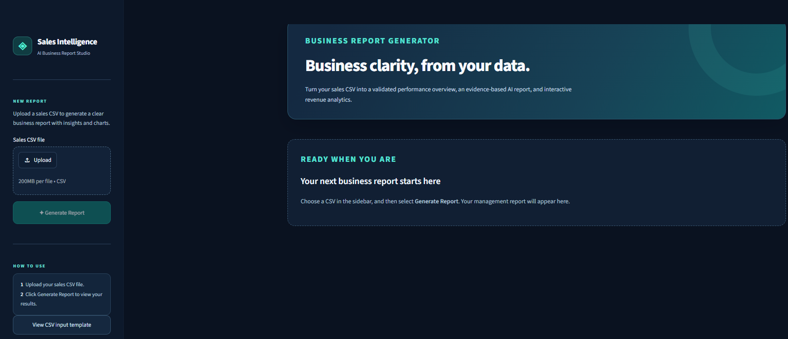
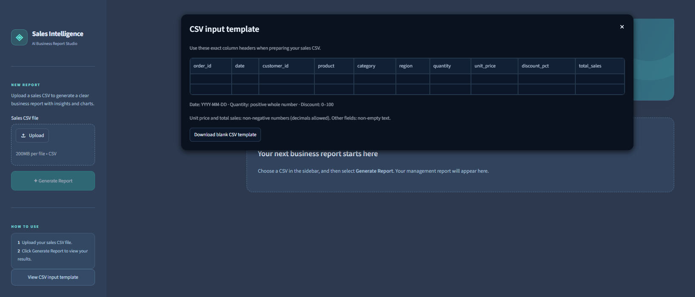
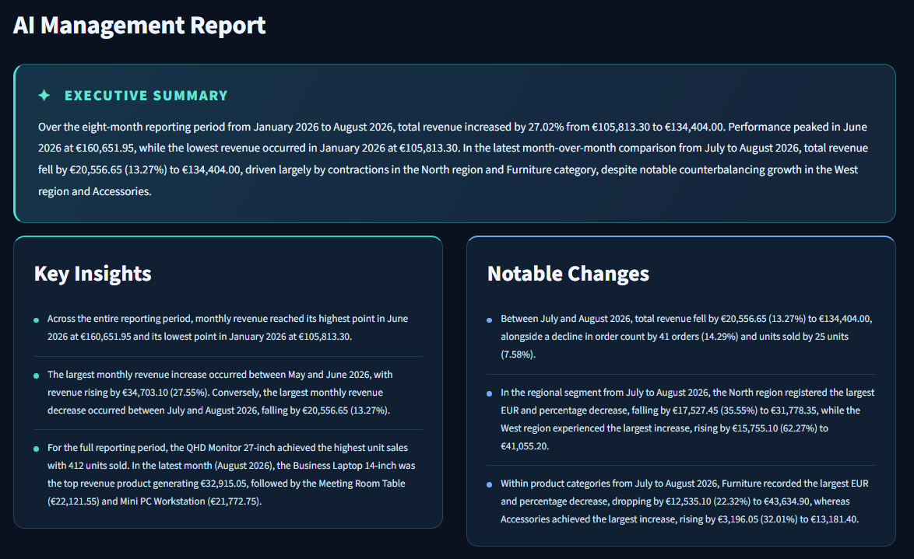
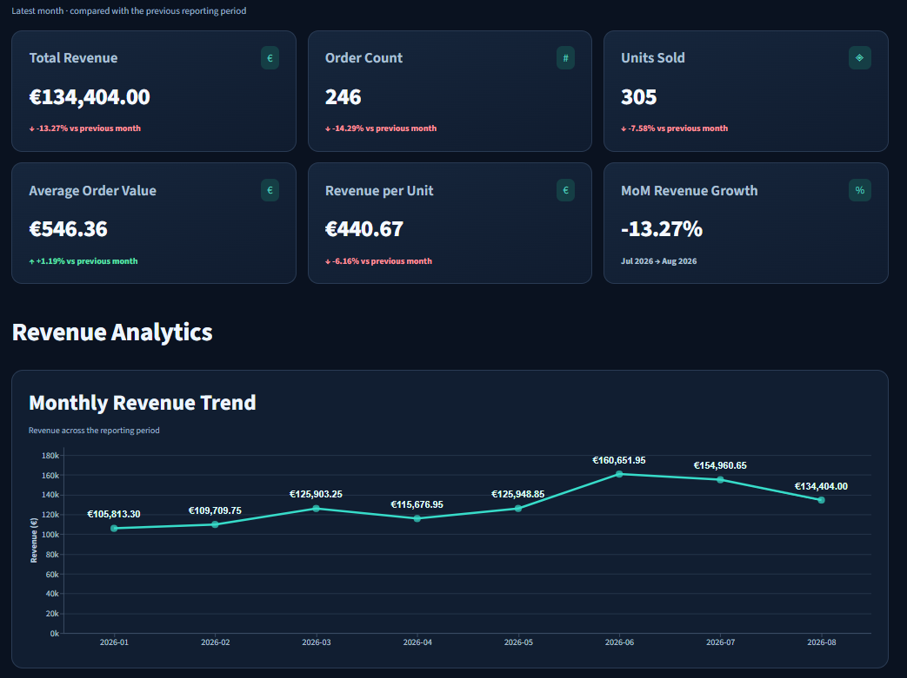
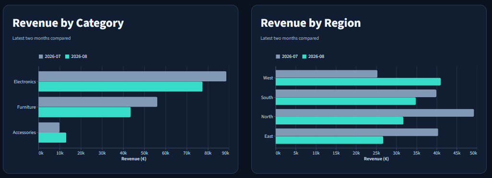

# Sales Intelligence — AI Business Report Generator

Sales Intelligence converts sales CSV files into business performance reports with **validated financial metrics**, **AI-generated management summaries**, **interactive charts**, and **downloadable PDFs**.

The application separates numerical analysis from natural-language generation. Python validates the uploaded data and calculates the metrics; Google Gemini uses those calculated results to write an executive summary, key insights, and notable changes. The original CSV is not uploaded to Gemini.

## Features

- **CSV validation:** Checks required columns, date formats, numerical values, discounts, and line-item revenue consistency.
- **Business analytics:** Calculates monthly revenue, distinct orders, units sold, average order value, and revenue per unit.
- **Period comparisons:** Tracks changes across reported months, including category and regional performance, product rankings, and notable movements.
- **AI management report:** Uses Gemini to produce a structured executive summary, key insights, and notable changes from Python-derived analytical data.
- **Response validation:** Validates the generated JSON against a defined Pydantic schema.
- **Interactive dashboard:** Presents KPIs and revenue trends using Streamlit and Altair.
- **PDF export:** Produces a formatted report using ReportLab from the existing results, without another Gemini request.
- **Graceful error handling:** Keeps computed KPIs and charts available when the AI narrative cannot be generated.


## Application Preview

Screenshots of the Streamlit application, from preparing a CSV to viewing the generated report.

### Main page



### CSV input template



### AI management report



### Key performance indicators and revenue trend



### Category and regional revenue comparisons



## Architecture

```text
Sales CSV
   |
   v
Streamlit dashboard (frontend/app.py)
   |  HTTP POST /reports (CSV upload)
   v
FastAPI endpoint (backend/app/api/reports.py)
   |  Python function calls
   v
CSV validation + analytics (backend/app/analytics/)
   |  Calculated KPIs, comparisons, and rankings
   v
LLM service (backend/app/services/llm_service.py)
   |  Prepares a prompt from calculated results
   v
Gemini provider (backend/app/services/llm_providers.py)
   |  Google GenAI SDK -> HTTPS request -> Google Gemini API
   |  Google GenAI SDK <- HTTPS response <- Google Gemini API
   v
LLM service: parse JSON and validate Pydantic schema
   |  Return analytics + optional AI narrative
   v
FastAPI endpoint
   |  HTTP JSON response
   v
Streamlit: KPI cards, Altair charts, and ReportLab PDF export
```

FastAPI, analytics, and Gemini integration are all Python code within the same backend. They communicate through function calls; the external communication occurs between Streamlit and FastAPI, and between the Google GenAI SDK and Gemini.

**Technology stack:** Python, FastAPI, Pandas, Pydantic, Google GenAI SDK, Google Gemini API, Streamlit, Altair, and ReportLab.

The application processes reports on demand and does not require a database.

 

## Getting started

### Prerequisites

- **Python 3.14**, used for development and testing.
- A [Google Gemini API key](https://aistudio.google.com/apikey) for AI narrative generation.

### 1. Clone and install

```bash
git clone https://github.com/Shay-hjn/AI-Business-Report-Generator.git
cd AI-Business-Report-Generator
```

**Windows (PowerShell)**

```powershell
python -m venv .venv
.\.venv\Scripts\Activate.ps1
python -m pip install -r requirements.txt
Copy-Item .env.example .env
```

**macOS / Linux**

```bash
python3 -m venv .venv
source .venv/bin/activate
python -m pip install -r requirements.txt
cp .env.example .env
```

### 2. Configure Gemini

Edit the local `.env` file and add your API key:

```dotenv
LLM_PROVIDER=gemini
LLM_MODEL=gemini-3.8-flash
GEMINI_API_KEY=your_gemini_api_key
LLM_RETRY_CONTENT_VALIDATION=0
```

`LLM_MODEL` selects the Gemini model used for generation. If you need a different model, you can manually choose an alternative such as `gemini-3.6-flash`, `gemini-3.5-flash-lite`, or `gemini-3.1-flash-lite`, then restart FastAPI. Model availability and quotas depend on your API key and can change.

Additional configuration:

| Setting | Default | Description |
| --- | --- | --- |
| `LLM_THINKING_LEVEL` | `medium` | Gemini thinking level: `low`, `medium`, or `high` |
| `LLM_MAX_OUTPUT_TOKENS` | `6000` | Output token limit |
| `LLM_RETRY_CONTENT_VALIDATION` | `0` | Set to `1` to allow one additional generation attempt when JSON parsing or schema validation fails |

### 3. Run the application

Start **FastAPI** in one terminal:

```powershell
python -m uvicorn backend.app.main:app --reload
```

Start **Streamlit** in another terminal, with the same virtual environment activated:

```powershell
python -m streamlit run frontend/app.py
```

Open **http://localhost:8501** to upload a CSV, generate a report, view the analytics, and download the PDF.

The backend runs at **http://127.0.0.1:8000**, with interactive API documentation at **http://127.0.0.1:8000/docs**.

## CSV input format

The dashboard provides a blank CSV template. Use the following column names in your CSV file:

```csv
order_id,date,customer_id,product,category,region,quantity,unit_price,discount_pct,total_sales
```

| Field | Requirement |
| --- | --- |
| `order_id`, `customer_id`, `product`, `category`, `region` | Non-empty text |
| `date` | Valid date in `YYYY-MM-DD` format |
| `quantity` | Positive whole number |
| `unit_price` | Non-negative number |
| `discount_pct` | Percentage from 0 to 100 |
| `total_sales` | Non-negative number matching calculated line-item revenue |

Each CSV row represents a sales line item. Multiple rows can share an `order_id`; monthly order counts use distinct order IDs.

The expected line-item calculation is `quantity × unit_price × (1 − discount_pct / 100)`.

Validation allows a difference of up to approximately **€0.01** for rounding. All monetary figures are interpreted as **EUR**.

The [`data/samples/`](data/samples/) directory provides synthetic datasets covering growth, contractions, unusual volume/revenue relationships, missing reporting months, zero revenue, and ranking ties. `sales_07_corrupted_missing_column.csv` is intentionally invalid and can be used to test CSV validation errors.

## API endpoints

| Method | Endpoint | Description |
| --- | --- | --- |
| `GET` | `/health` | Health check returning `{"status":"ok"}` |
| `POST` | `/reports` | Accepts a multipart CSV upload in the `file` field and returns the report as JSON |
| `GET` | `/docs` | Interactive OpenAPI documentation |

Example request with FastAPI running:

```bash
curl -X POST http://127.0.0.1:8000/reports \
  -F "file=@data/samples/sales_01_steady_growth.csv"
```

Invalid CSV input produces **HTTP 422**. When the CSV is valid but Gemini is unavailable or returns a response that fails JSON or schema validation, the API still returns the computed analytics, with `narrative_generated: false` and `ai_report: null`.

## Testing

Run the offline regression suite:

```bash
python -m pytest tests/ -q
```

Tests cover CSV validation, KPI calculations, period and segment comparisons, API responses, Gemini response formatting, PDF generation, and selected frontend behavior. Model responses are mocked, so the suite does not make live Gemini API calls.

## Design decisions

| Decision | Reason |
| --- | --- |
| Calculate financial metrics in Python | LLMs can make arithmetic errors or hallucinate numerical values. Python provides deterministic, testable, and reproducible calculations. |
| Send aggregated analytical data to Gemini | Focuses the model on business interpretation and report writing without sending raw transaction data. |
| Validate structured AI responses with Pydantic | Ensures responses follow the required schema for the dashboard and PDF exporter. |
| Separate the API, analytics, and presentation layers | Improves modularity, testability, and maintainability. |
| Keep analytics available if AI generation fails | Preserves calculated metrics and charts when Gemini is unavailable or returns an invalid response. |
| Generate PDFs from the existing API response | Reuses calculated results and AI narratives without duplicate analysis or additional Gemini API calls, avoiding duplicate calculations.  |
| Avoid unnecessary database integration | Reports are generated on demand and can be saved as PDFs. Since persistent storage and user accounts are not required for the current workflow, a database would add unnecessary complexity. |

## Limitations

| Limitation | Description |
| --- | --- |
| Currency | All prices and sales amounts are treated as euros (€). Other currencies are not currently supported. |
| Missing months | If a month is missing from the CSV, the application does not assume that sales were zero. Comparisons use the months available in the data, even if they are not consecutive. |
| AI accuracy | Gemini generates business insights from Python-calculated data, but its explanations may still contain mistakes. Important findings should be reviewed before making business decisions. |
| Model availability | Gemini models have different availability, usage limits, and response times. Model selection is manual, with no automatic switching if a model becomes unavailable. |
| Local setup | Streamlit connects to FastAPI at `127.0.0.1:8000`. Deploying the frontend and backend separately would require configuring the backend URL. |

## Possible future improvements

| Improvement | Description |
| --- | --- |
| Multi-agent AI validation | Introduce a second LLM to review the first model's report, checking numerical claims and business interpretations against the Python-calculated results. This could improve reliability, although it would not guarantee accuracy. |
| More advanced AI models | Support higher-capability models, including paid options, to potentially improve the depth and quality of business insights. |
| Automatic model fallback | Automatically switch to another configured Gemini model when the primary model is unavailable, reaches its usage limit, or encounters certain API errors. |
| Multi-currency support | Allow users to select a currency and optionally support currency conversion using exchange rates. |
| Customizable reports | Let users choose which KPIs, categories, regions, and time periods to include in their reports. |
| Background report generation | Process large datasets or slow AI requests in the background, allowing users to continue using the interface while their reports are being prepared. |
| Scheduled reporting | Allow users to generate reports automatically at regular intervals, such as weekly or monthly. |

## Project structure

```text
AI-Business-Report-Generator/
│
├── backend/
│   └── app/
│       ├── analytics/          # CSV validation, KPIs, insights, and pipeline
│       ├── api/                # FastAPI report endpoint
│       ├── services/           # Gemini integration and response validation
│       ├── schemas.py          # Pydantic data models
│       └── main.py             # FastAPI application
│
├── frontend/
│   ├── app.py                  # Streamlit dashboard
│   ├── styles.css              # Dashboard styling
│   └── pdf_export.py           # PDF report generation
│
├── data/
│   └── samples/                # Synthetic CSV test datasets
│
├── docs/
│   └── images/                # Application screenshots
│
├── scripts/                   # Local diagnostic tools
├── tests/                     # Automated regression tests
│
├── .streamlit/
│   └── config.toml             # Streamlit configuration
│
├── .env.example                # Environment variable template
├── .gitignore                  # Git exclusion rules
├── requirements.txt            # Python dependencies
└── README.md                   # Project documentation
```
